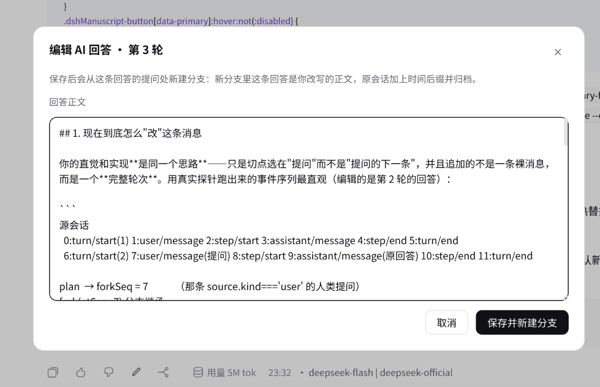

# dsh-revise-chan（修订酱）

[English](README_EN.md) | 中文

[](https://www.npmjs.com/package/dsh-revise-chan)
[](https://github.com/shellexy/dsh-revise-chan/blob/main/LICENSE)
[](#兼容性)

**让 dsh 可以修改 AI 回答内容 + 固定显示大纲。**

给 [DeepSeek Harness](https://github.com/deepseek-ai/deepseek-harness)（`dsh`）的对话补上三件「把回答当文稿来管」的事：**署名**、**修订**、**目录**。



- **署名**：每条回答下方的时间行末尾补上 `模型 | 提供方`，取自这一轮回答的 token 计量归属（`turn-tail.tokenUsage.routes`，即真正被计费的那次路由；Chat 折叠没有这条时回退到消息自带的 `providerMetadata`）。
- **修订**：复制按钮右边多一支铅笔。点开一个应用内对话框改回答正文，保存后从这条回答的**提问处**新建分支——新分支里这条回答就是你改写的正文；分支名加 `·<保存时间>`，原会话标题加 `·<原回答时间>` 并归档。
- **目录**：对话标题栏多一个「大纲」按钮，打开右侧栏里的常驻大纲页：列出每个已开始的轮次（提问 + 回答预览），高亮当前所在轮次，点任意一条跳到该轮（未载入的轮次会先按 `turnOutline` 的 `seq` 把历史翻页到那一轮）。

## 安装

从 npm：

```bash
dsh plugin --profile web add dsh-revise-chan
```

直接从 GitHub：

```bash
dsh plugin --profile web add github:shellexy/dsh-revise-chan
```

本地源码（改完即用，无需构建）：

```bash
git clone https://github.com/shellexy/dsh-revise-chan.git
dsh plugin --profile web add ./dsh-revise-chan
```

装完重启正在运行的 `dsh web`（Host 半需要重启才能加载 `revise-chan` Remote；Browser 半刷新页面即生效）。

## 兼容性

- 目标 dsh `0.2.0-rc.2`（0.2.x 的 session / surface / slot 契约）。纯 JavaScript、**无构建步骤、无 npm 依赖**：Host 半不 import 任何包（Remote marker 与 Typert binding 手工安装，见下），Browser 半只 `require('react')`。
- 未在 0.1.x 上验证：0.1.x 的 surface 契约与 Remote endpoint 形状不同，`revise` 依赖 0.2.x 的行为。

## 功能 2 到底做了什么

dsh 的会话日志是只追加、深度冻结的，而且 `assistant/message` **不能**做 surface replacement（它要求引用被遮蔽的节点，又禁止携带 `sourceEventSeqs`），所以「改写历史里那条回答」在 0.2.x 上无法字面实现。稿本改用一条完全申报的路径：

1. `revise-chan/plan` 在来源会话的日志里定位这条回答所属轮次的**人类提问**事件序号（只有 `source.kind === 'user'` 的 `user/message` 才算）。
2. Browser 半在那一格 `sessions.fork({ atSeq })`——子会话原样继承到提问为止：提问还在，原回答不在，子会话自己的 `turn/end` 由 fork 合成闭包补上。
3. `revise-chan/revise` 往这个还活着的子会话里**追加**一个完整轮次：`turn/start`（沿用该轮轮次号）→ `step/start` → `assistant/message`（正文＝你的修订稿，沿用原消息 id、provider、model，保留思考块与图片，丢弃工具调用）→ `step/end` → `turn/end`。

一次真实修订在日志里长这样：

```
源会话
  0:turn/start(1) 1:user/message 2:step/start 3:assistant/message 4:step/end 5:turn/end
  6:turn/start(2) 7:user/message(提问) 8:step/start 9:assistant/message(原回答) 10:step/end 11:turn/end

fork(atSeq=7) 分支继承
  0:turn/start(1) … 5:turn/end  6:turn/start(2) 7:user/message 8:session/end-seed 9:turn/end(fork 合成闭包)
  → 折叠：[提问1, 回答1, 提问2]

revise 追加
  10:turn/start(2) 11:step/start(2,1) 12:assistant/message(修订稿) 13:step/end 14:turn/end(2)
  → 折叠：[提问1, 回答1, 提问2, 修订后的回答]
```

结论：模型可见历史（surface 折叠）在分支里读作 `…, 提问, 修订后的回答`；旧事件一条没动，压缩摘要、token 计量、轨迹视图都照常。沿用同一轮次号还有一个好处：宿主 Agent 在 fork 时就已把下一轮号定为 N+1，分支里继续发消息不会和这条修订回答撞号。

## 已知边界

- 修订会**丢掉原轮次的工具调用链**：那些工具确实属于被丢弃的分支，新分支不能替它们认领结果。思考块与图片保留。
- 压缩摘要已经吞掉该轮时无法修订：宿主返回 `message-not-found`，对话框照实说明。
- 会话标题有 UTF-8 80 字节上限（`session-title` 的 `maxTitleBytes`），宿主是**截断**而不是拒绝。所以插件先把原标题按字节裁到 62 字节再补 `·YYYY-MM-DD HH:mm`，避免宿主的截断吃掉时间戳后缀；同一会话反复修订时，旧时间戳后缀会先被剥掉再重新加。
- 大纲的「跳到某轮」和「当前轮次高亮」依赖宿主为自身锚点发布的 `[data-conversation-scroll]` / `[data-chat-turn]` 属性；日后改名只会让跳转和高亮失效，大纲列表本身不受影响。
- 右侧栏大纲页是插件能提供的最接近「一直显示」的形态：宿主没有开放跨插件的对话区滚动，所以跳转走的是上面的 DOM 锚点。

## 实现说明

| 文件 | 职责 |
|---|---|
| `index.js` | Host 半：`revise-chan` Remote 命名空间（`plan` / `revise`）。Remote marker 直接按 `@deepseek-ai/dsh-typert-protocol/remote-methods` 的描述符安装，因此纯 JavaScript 无需装饰器或 typert 生成物。 |
| `client.js` | Browser 半：署名与编辑按钮（`conversation.chat.assistant-actions`）、编辑对话框（`shell.overlay`）、大纲按钮（`conversation.session.header.utilities`）与大纲页（`sidebar.right.pane.tab`）。 |
| `cordis.patch.yml` | 把 `dsh-revise-chan` 这一行插进 profile 的 Loader 配置。 |

Browser 半只 `require('react')`，不引用任何 Harness Client 包；样式全部走 `--dsw-*` 主题 token，界面文案走 `locale.register` 的中英文词典。

### 为什么 Host 半零 import

`dsh plugin add <本地路径>` 装进 profile 的是 `link:`，Node 会从**真实路径**解析裸包名，于是 `@deepseek-ai/dsh-typert-protocol` 这类包解析不到（加载时报 "failed to import"）。所以 Host 半不 import：

- Remote 方法标记 = 往原型上装一个 `'@deepseek-ai/dsh-typert-protocol/remote-methods'` 描述符（`{ version: 1, methods: [{ method, invocation: { kind: 'direct' } }] }`）；
- 服务注册 = `ctx.provide('revise-chan', instance)`，实例自挂 `typertRemote = { service, serviceKey, namespace }`。

网关的 SRC 发现读的就是这两样东西，行为与 `TypertRemoteService` + `@Remote` 装饰器等价。

## 已验证到什么程度

可复跑的部分都在 [`tools/`](tools/README.md)：三个离线验证（宿主半发现与行为、引擎折叠语义、Browser 半注册与保存事务）和一个端到端验证（启一个一次性 profile，走真实 Typert Gateway）。

```bash
bash tools/verify-all.sh          # 离线：不需要模型，不联网
bash tools/verify-all.sh --e2e    # 再启一次性 profile 走真实网关
```

在 dsh `0.2.0-rc.2` 上的结论：

- **真实网关**：`ctx.typertGateway.invoke({ namespace: 'revise-chan', method: 'plan' | 'revise', args: { request } })` 可解析并执行；分支折叠为 `[提问, 修订后的回答]`，`turnBoundary.lastTurn` 保持原轮次号（后续轮次不撞号）。
- **真实引擎**：`buildForkSeed` + `Session.create` 复现「提问处 fork + 追加同轮修订回答」，`deriveMessages()` 与上面一致，且继承前缀逐事件与来源相同。
- **Browser 半**：每个注册入口都能用真实 slot props 渲染出预期元素树，`saveRevision` 发出的 RPC 载荷 / fork / 改名 / 归档 / 打开分支全部符合预期，并且六个槽位项在运行中的页面上都是 `active: true`。
- **未验证**：真实浏览器里的布局、配色与悬停观感——那部分需要人眼。

