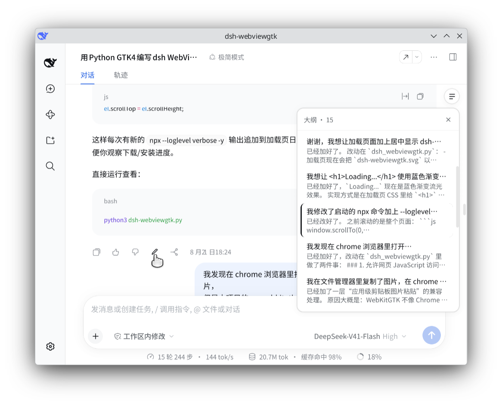

# dsh-revise-chan

English | [中文](README.md)

[](https://www.npmjs.com/package/dsh-revise-chan)
[](https://github.com/shellexy/dsh-revise-chan/blob/main/LICENSE)
[](#compatibility)

**Edit an AI answer's content in dsh, and show the outline in a floating panel.**

Three things that make a [DeepSeek Harness](https://github.com/deepseek-ai/deepseek-harness) (`dsh`) conversation behave like an editable manuscript: **byline**, **revision**, **outline**.



- **Byline** — every answer's clock row gains `model | provider`, read from that turn's billed route (`turn-tail.tokenUsage.routes`), falling back to the message's own `providerMetadata` when the Chat fold does not carry it.
- **Revision** — a pencil sits beside the copy button. It opens an in-app dialog over the answer body; saving branches from that answer's **human prompt**, so the branch's answer *is* your rewritten text and the branch **keeps the original title** (you stay in "the same" conversation). The version it supersedes gains a `·<edit time>` suffix and is archived.
- **Outline** — a floating button at the conversation's top-right opens a list pinned beside the conversation column: one row per started turn (one line of question plus two of answer preview, with preview-less turns falling back to their turn number), the current turn highlighted, and any row jumps to its turn (turns outside the loaded window page history in through the `turnOutline` projection's `seq` first). The panel fills the conversation band down to the composer, and a press anywhere outside it (or Escape / ✕ / the toggle) collapses it. It is an overlay rather than a right-sidebar page, so it costs no column width, needs no sidebar, and leaves the Host's own hover rail untouched.

## Install

From npm:

```bash
dsh plugin --profile web add dsh-revise-chan
```

Straight from GitHub:

```bash
dsh plugin --profile web add github:shellexy/dsh-revise-chan
```

From a local checkout (no build step needed):

```bash
git clone https://github.com/shellexy/dsh-revise-chan.git
dsh plugin --profile web add ./dsh-revise-chan
```

Restart the running `dsh web` afterwards: the Host half has to load the `revise-chan` Remote. The Browser half only needs a page refresh.

## Compatibility

- Targets dsh `0.2.0-rc.2` (the 0.2.x session / surface / slot contracts). Plain JavaScript, **no build step, no npm dependencies**: the Host half imports nothing (the Remote marker and Typert binding are installed by hand, see below) and the Browser half only `require`s `react`.
- Not verified on 0.1.x: the surface contract and Remote endpoint shape there differ from what `revise` relies on.

## What "revision" actually does

A dsh session log is append-only and deep-frozen, and `assistant/message` **cannot** be surface-replaced (the operation must cite the node it shadows, while that event type forbids `sourceEventSeqs`). Rewriting the answer in place is therefore impossible on 0.2.x. dsh-revise-chan takes a fully declared route instead:

1. `revise-chan/plan` finds the **human prompt** of the turn whose answer was edited (only a `user/message` with `source.kind === 'user'` counts — injected context does not).
2. The Browser half forks there with `sessions.fork({ atSeq })`: the child inherits everything through the prompt, title included — the question is still there, the original answer is not, and the fork's own synthetic plain `turn/end` closes the cut turn.
3. `revise-chan/revise` **appends** one complete turn to that live child: `turn/start` (reusing the edited turn's number) → `step/start` → `assistant/message` (your text, same message id / provider / model, reasoning and images kept, tool calls dropped) → `step/end` → `turn/end`.

One real revision looks like this in the log:

```
source session
  0:turn/start(1) 1:user/message 2:step/start 3:assistant/message 4:step/end 5:turn/end
  6:turn/start(2) 7:user/message(question) 8:step/start 9:assistant/message(original) 10:step/end 11:turn/end

fork(atSeq=7)
  0:turn/start(1) … 5:turn/end  6:turn/start(2) 7:user/message 8:session/end-seed 9:turn/end(fork closer)
  → folds to [question1, answer1, question2]

revise appends
  10:turn/start(2) 11:step/start(2,1) 12:assistant/message(revision) 13:step/end 14:turn/end(2)
  → folds to [question1, answer1, question2, revised answer]
```

The model-visible surface (the canonical fold) reads `…, question, revised answer`; no earlier event is touched, so compaction, token accounting and the trajectory view keep working. Reusing the turn number matters: the Host Agent already reserved `N+1` when it forked, so continuing the branch cannot collide with this answer.

## Known limits

- A revision **drops the edited turn's tool calls**: those tools belong to the discarded branch and the new one cannot claim their results. Reasoning and images are kept.
- A turn already swallowed by a compaction summary cannot be revised: the Host answers `message-not-found` and the dialog says so.
- Session titles cap at 80 UTF-8 bytes (`session-title`'s `maxTitleBytes`) and the Host **truncates** rather than rejects. The plugin therefore clips the inherited title to 62 bytes before appending `·YYYY-MM-DD HH:mm`, so the stamp survives; re-editing strips the previous stamp first.
- The outline's jump, its active-turn highlight, and the floating button's position all read the anchors the Host publishes for its own navigation (`[data-conversation-scroll]`, `[data-chat-turn]`). If a future version renames them, only those three go quiet (no button, no follow) — the outline data itself is unaffected.
- The panel's position **and height** are measured: pinned to the conversation scrollport's top-right, as tall as "scrollport minus composer" (the Host publishes `--dsh-composer-height` on the scrollport; reading nothing falls back to the rail's own 152px), so it never covers the send button. It disappears entirely when no Conversation is mounted (another main panel, or the trajectory view): the outline serves the chat transcript.
- Each row is one line of question plus two lines of answer preview (the rail's own density) and spends no line on "Turn N"; only a turn with **neither** a prompt nor a response preview (image-only or command-only turns) falls back to the turn number in that slot, and the number always stays in the hover title and `aria-label`.
- Any press outside the panel and its toggle collapses it (captured `pointerdown`), while a press inside (jumping to another turn) leaves it up — as do Escape, ✕, and the toggle. Each session remembers whether it was open, for the page's lifetime.

## Implementation

| File | Role |
|---|---|
| `index.js` | Host half: the `revise-chan` Remote namespace (`plan` / `revise`). The Remote method marker is installed directly as the `@deepseek-ai/dsh-typert-protocol/remote-methods` descriptor, so plain JavaScript needs neither decorators nor generated typert output. |
| `client.js` | Browser half: byline and edit action (`conversation.chat.assistant-actions`), editor dialog (`shell.overlay`), outline bridge (`conversation.input.dock`, publish-only) and the floating outline (`shell.overlay`). |
| `cordis.patch.yml` | Inserts the `dsh-revise-chan` row into the profile's Loader configuration. |

The Browser half only `require`s `react` and imports no Harness Client package; all styling uses `--dsw-*` theme tokens and all copy goes through `locale.register` dictionaries (Chinese + English).

### Why the Host half imports nothing

`dsh plugin add <local path>` installs a `link:`, so Node resolves bare specifiers from the **real** path of this directory — where `@deepseek-ai/dsh-typert-protocol` and friends cannot be found (the row then fails with "failed to import"). So the Host half installs what those helpers would install:

- the Remote method marker is a prototype descriptor `'@deepseek-ai/dsh-typert-protocol/remote-methods'` holding `{ version: 1, methods: [{ method, invocation: { kind: 'direct' } }] }`;
- the service is registered with `ctx.provide('revise-chan', instance)`, and the instance carries `typertRemote = { service, serviceKey, namespace }`.

That is exactly what the gateway's source-mode discovery reads, so the behaviour matches `TypertRemoteService` + the `@Remote` decorator.

## Verification

Everything reproducible lives in [`tools/`](tools/README.md): three offline verifiers (Host discovery + behaviour, engine fold semantics, Browser registrations and save transaction) and an end-to-end one that boots a throwaway profile and drives the real Typert Gateway.

```bash
bash tools/verify-all.sh          # offline: no model, no network
bash tools/verify-all.sh --e2e    # also boots a throwaway dsh profile
```

Verified on dsh `0.2.0-rc.2`:

- **Real gateway** — `ctx.typertGateway.invoke({ namespace: 'revise-chan', method: 'plan' | 'revise', args: { request } })` resolves and runs; the branch folds to `[question, revised answer]` and `turnBoundary.lastTurn` keeps the edited turn's number.
- **Real engine** — `buildForkSeed` + `Session.create` reproduce the branch, and `deriveMessages()` matches the fold above.
- **Browser half** — `tools/lib/mini-react.mjs` supplies a miniature React runtime with state and effects, so the checks cover the interactions themselves: byline text, pencil gating and hand-off, editor draft, the outline toggle appearing, the panel opening and listing turns, the active-turn highlight, a jump from an unloaded turn paging in first, closing, and withdrawal when the Conversation unmounts — plus `saveRevision`'s RPC payloads, fork boundary, the new title rule (only the superseded session is stamped) and the archive order.
- **Not verified** — visual layout, colours and hover feel in a real browser; that part needs human eyes.
